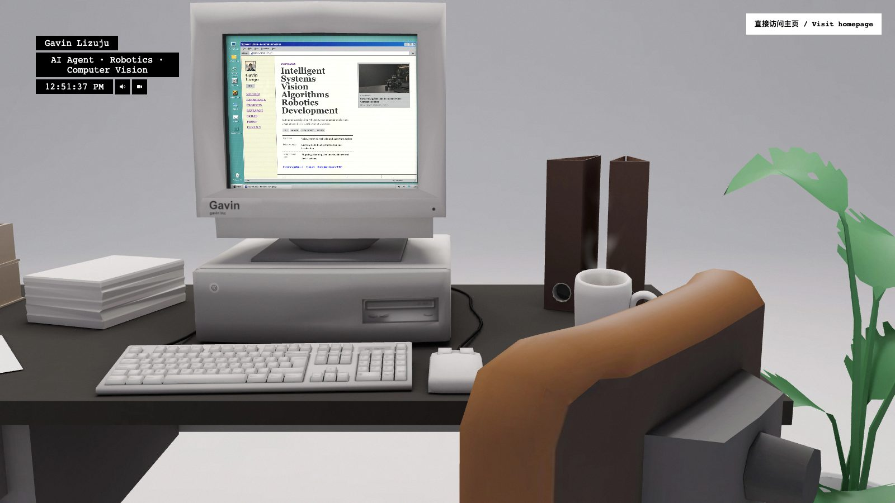
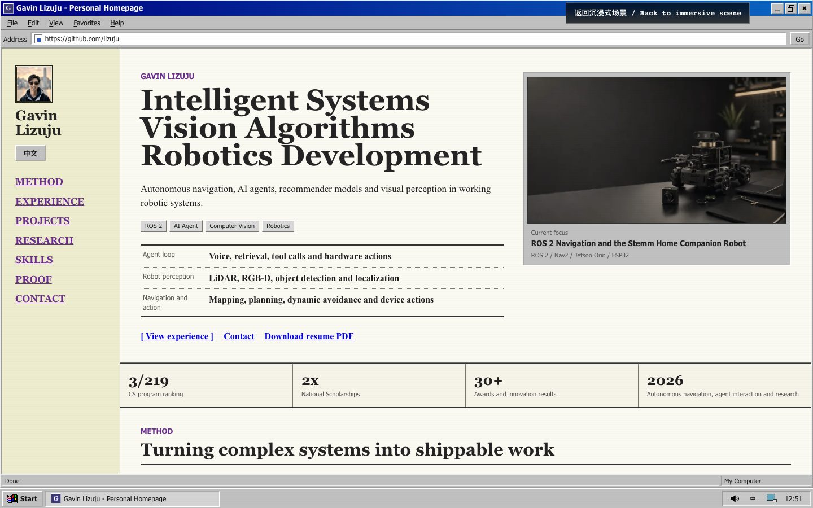
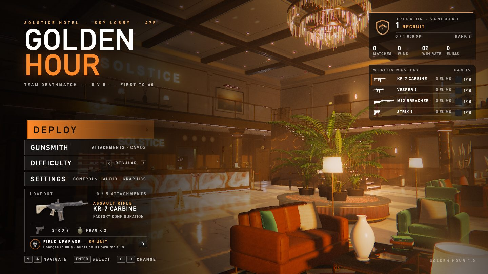
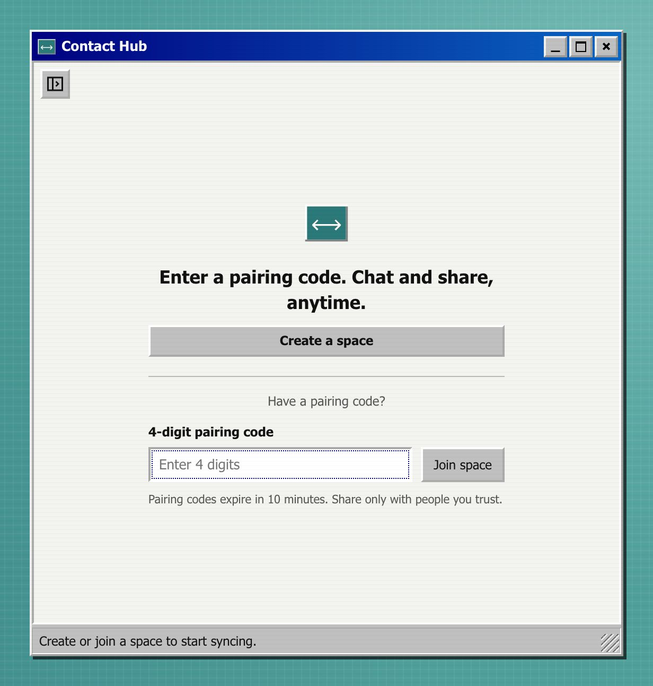
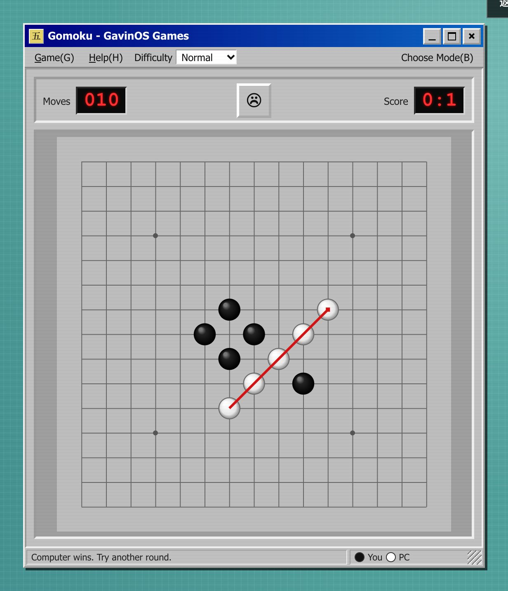
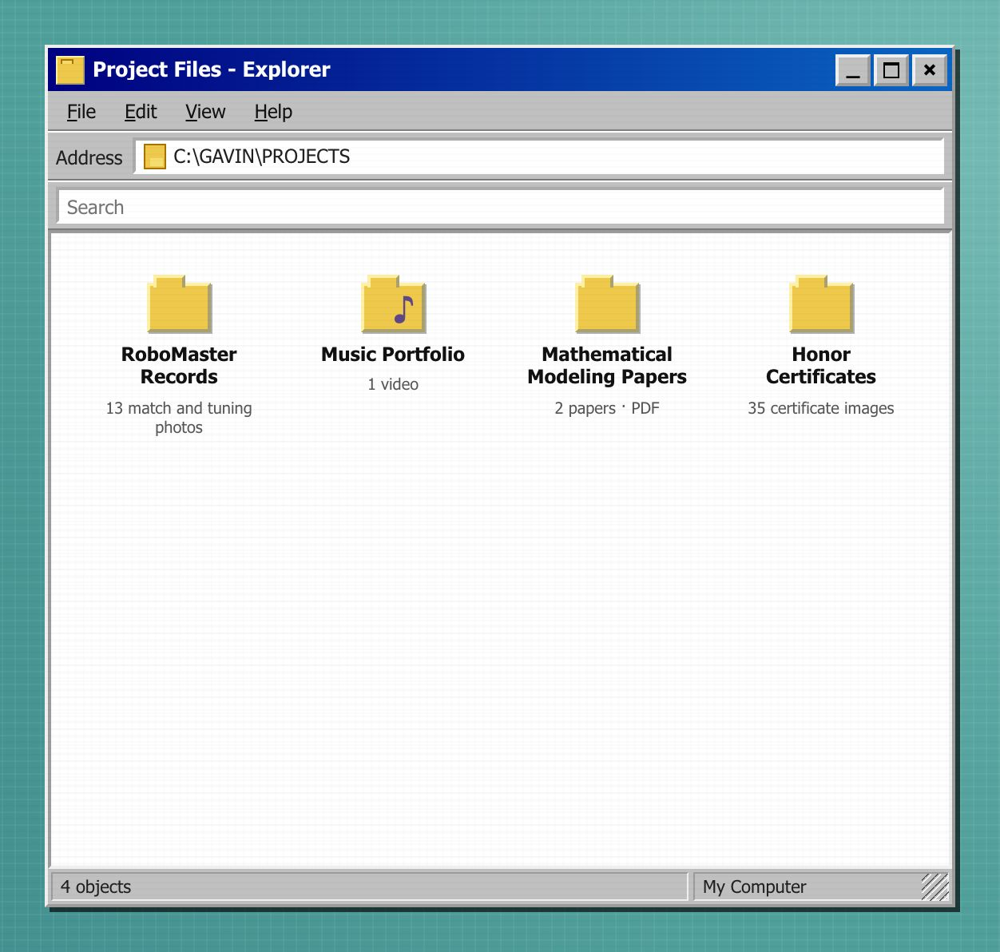
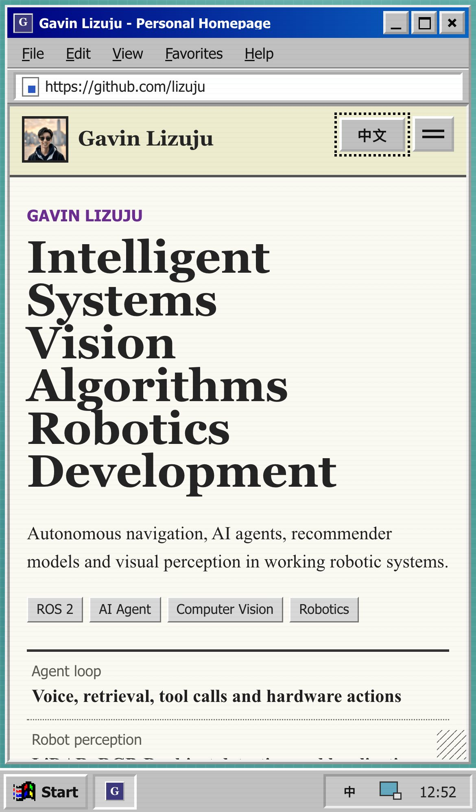

<div align="center">



# Gavin Lizuju · Immersive Portfolio

**A 3D desk, a CRT, and a working turn-of-the-century desktop: the portfolio of 李祖钜 Gavin.**

[**Visit lizuju.github.io →**](https://lizuju.github.io) &nbsp;·&nbsp; English &nbsp;|&nbsp; [简体中文](README.zh-CN.md)

[](https://github.com/lizuju/lizuju.github.io/actions/workflows/ci.yml)     [](LICENSE)

</div>

## Inside the desktop

<table>
  <tr>
    <td width="50%"></td>
    <td width="50%"></td>
  </tr>
  <tr>
    <td><b>Retro desktop</b><br>Draggable windows, taskbar, Start menu, 中/EN switch and a system-wide mute.</td>
    <td><b>Golden Hour</b><br>A full 3D shooter in a sandboxed window: Chinese and English, quality presets, reflections and frame rate settings.</td>
  </tr>
  <tr>
    <td></td>
    <td></td>
  </tr>
  <tr>
    <td><b>Contact Hub</b><br>End-to-end encrypted chat and file sync, paired with a 4-digit code.</td>
    <td><b>Gomoku</b><br>Minesweeper-style board with a minimax opponent.</td>
  </tr>
</table>

Also on the desktop: **Satellite Tracker** (live orbits, SGP4), **Project Files** (RoboMaster photos, papers, music) with an [honors gallery](https://lizuju.github.io/honors/), **E-mail** and a **Recycle Bin**.

## Desktop and phone

<table>
  <tr>
    <td width="66%"></td>
    <td width="34%"></td>
  </tr>
  <tr>
    <td>Computers enter the 3D room and use the desktop on the CRT. Heavy apps run in their own window; while a game is open the room freezes to leave the GPU to it.</td>
    <td>Phones skip the 3D scene and get the touch-friendly desktop directly.</td>
  </tr>
</table>

## Quick start

```bash
nvm use            # Node 22 (.nvmrc)
npm install
npm run dev        # http://127.0.0.1:8080
```

```bash
npm run build && npm run preview   # production build at http://127.0.0.1:3090
```

## Tests

```bash
npm run test:unit                   # unit tests
npm run test:smoke                  # Playwright: Chromium and WebKit, desktop and mobile
npm ci --prefix cloudflare/sync     # once, then:
npm test --prefix cloudflare/sync   # sync backend
```

## Layout

```text
src/                        3D room: three.js, TypeScript, React overlay
static/portfolio/           Retro desktop: window manager, apps, bilingual content
static/games/golden-hour/   Golden Hour: game bundle, language layer, desktop bridge
static/honors/  static/chat/  Standalone honors and chat pages
cloudflare/sync/            Sync backend: Workers + Durable Objects
bundler/  scripts/  tests/  Build config, tooling, Playwright and unit tests
```

## Release

- Pull requests run the backend tests, the build and the browser tests; merging to `main` publishes `docs/` to GitHub Pages.
- The sync Worker is deployed by hand (`npm run deploy` in `cloudflare/sync/`, see its [README](cloudflare/sync/README.md)). For a new sync protocol, raise `apiVersion` in `static/portfolio/sync-config.json` and `API_VERSION` in `cloudflare/sync/src/api-version.js` together and deploy the Worker first; CI checks the live Worker before publishing.
- The build refuses photos with EXIF or GPS data: run `npm run images:strip` after adding images.

## Credits

The 3D room is adapted from [henryjeff/portfolio-website](https://github.com/henryjeff/portfolio-website) ([MIT](licenses/henryjeff-portfolio-website-MIT.md)). The Gomoku opponent uses [`@algorithm.ts/gomoku`](https://www.npmjs.com/package/@algorithm.ts/gomoku) ([MIT](static/portfolio/licenses/algorithm-ts-gomoku-MIT.txt)).

Released under the [MIT License](LICENSE).
