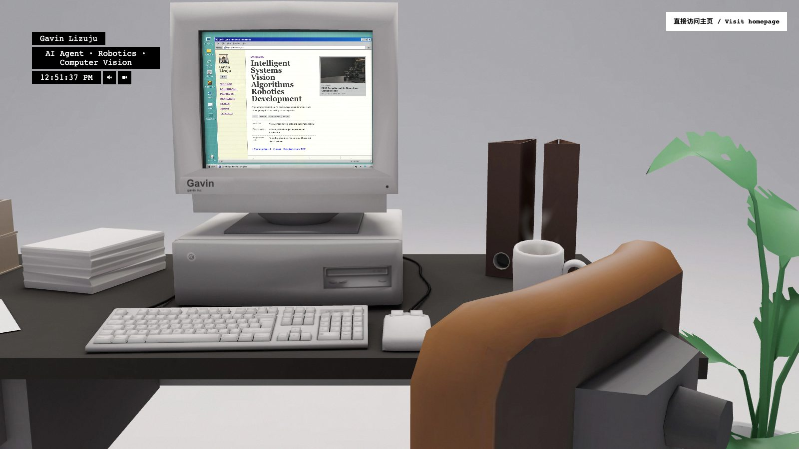
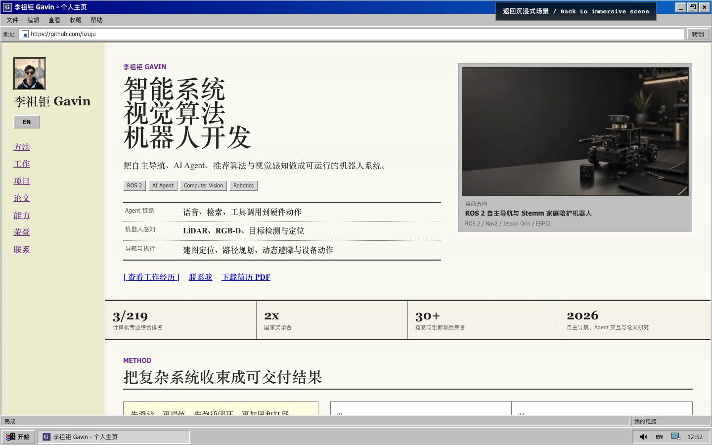
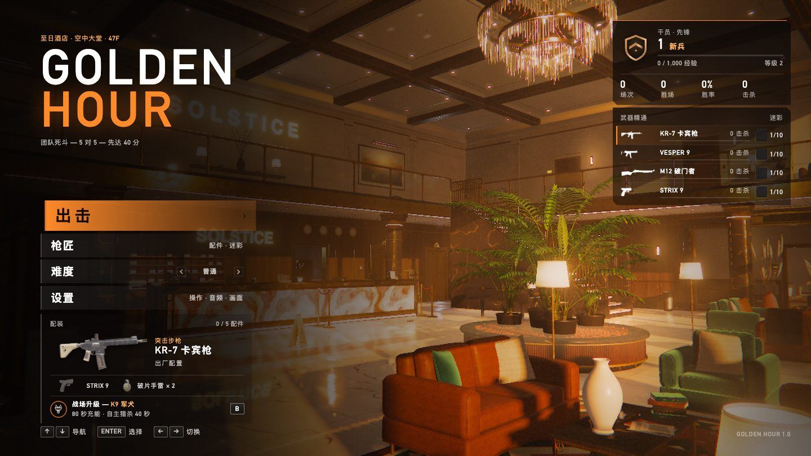
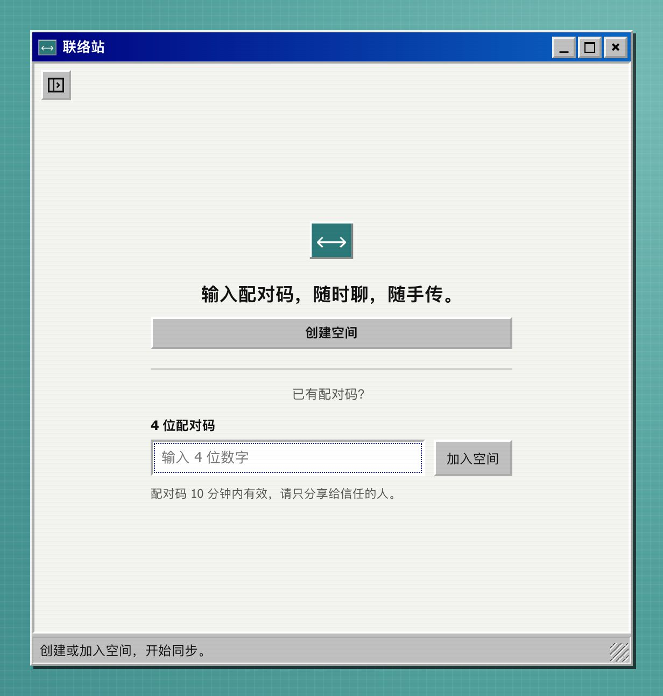
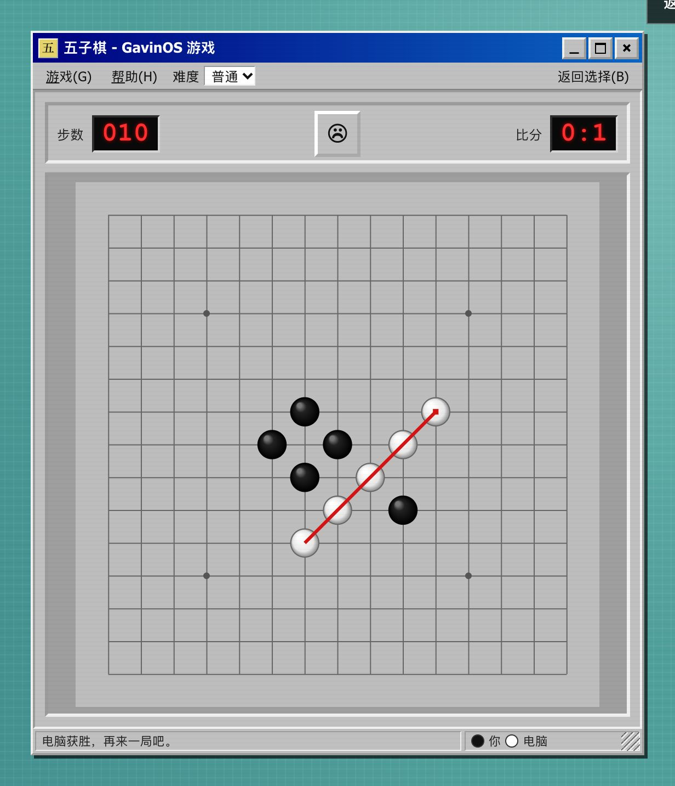
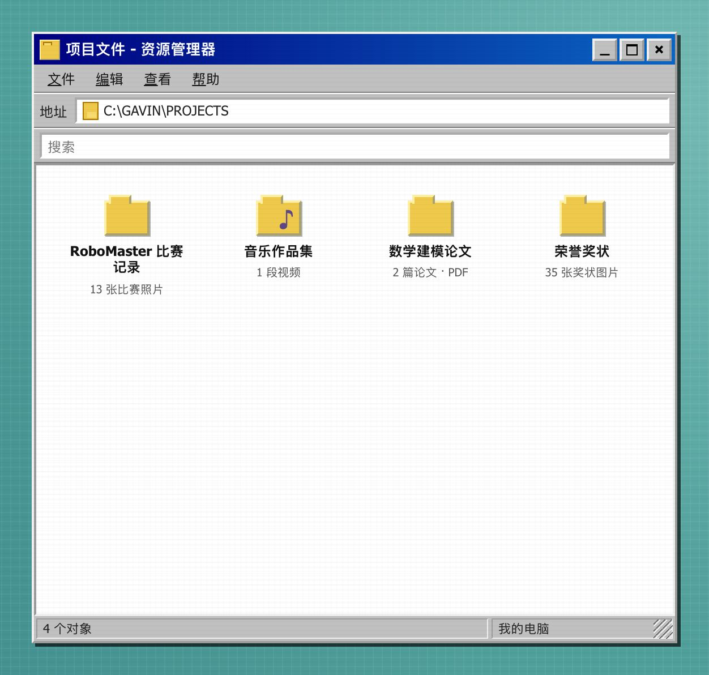
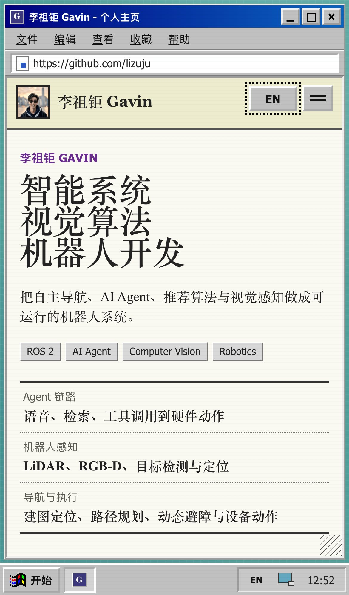

<div align="center">



# 李祖钜 Gavin · 沉浸式作品集

**一张 3D 书桌、一台 CRT 显示器，和一个真正能用的千禧年风格桌面。**

[**访问 lizuju.github.io →**](https://lizuju.github.io) &nbsp;·&nbsp; [English](README.md) &nbsp;|&nbsp; 简体中文

[](https://github.com/lizuju/lizuju.github.io/actions/workflows/ci.yml)     [](LICENSE)

</div>

## 桌面里有什么

<table>
  <tr>
    <td width="50%"></td>
    <td width="50%"></td>
  </tr>
  <tr>
    <td><b>复古桌面</b><br>可拖动缩放的窗口、任务栏、开始菜单、中/EN 切换和全局静音。</td>
    <td><b>黄金时刻</b><br>在隔离窗口里运行的完整 3D 射击游戏：中英双语，可调画质、地面反射和帧率上限。</td>
  </tr>
  <tr>
    <td></td>
    <td></td>
  </tr>
  <tr>
    <td><b>联络站</b><br>端到端加密的聊天和文件同步，4 位配对码即可连接。</td>
    <td><b>五子棋</b><br>扫雷风格的棋盘，配 minimax 电脑对手。</td>
  </tr>
</table>

桌面上还有：**卫星轨迹**（实时轨道，SGP4 推算）、**项目文件**（RoboMaster 照片、论文、音乐）和[荣誉奖状页](https://lizuju.github.io/honors/)、**电子邮件**、**回收站**。

## 电脑与手机

<table>
  <tr>
    <td width="66%"></td>
    <td width="34%"></td>
  </tr>
  <tr>
    <td>电脑上先进入 3D 房间，在 CRT 屏幕里使用桌面。重型应用在独立窗口运行，打开游戏时房间自动冻结，把显卡留给游戏。</td>
    <td>手机跳过 3D 场景，直接进入适合触屏的桌面。</td>
  </tr>
</table>

## 快速开始

```bash
nvm use            # Node 22（见 .nvmrc）
npm install
npm run dev        # http://127.0.0.1:8080
```

```bash
npm run build && npm run preview   # 生产构建，http://127.0.0.1:3090
```

## 测试

```bash
npm run test:unit                   # 单元测试
npm run test:smoke                  # Playwright：Chromium 与 WebKit，桌面与手机
npm ci --prefix cloudflare/sync     # 首次运行一次，然后：
npm test --prefix cloudflare/sync   # 同步后端
```

## 目录

```text
src/                        3D 房间：three.js、TypeScript、React 界面层
static/portfolio/           复古桌面：窗口管理、各个应用、中英文内容
static/games/golden-hour/   黄金时刻：游戏包、语言层、与桌面的通信
static/honors/  static/chat/  独立的荣誉页和聊天页
cloudflare/sync/            同步后端：Workers + Durable Objects
bundler/  scripts/  tests/  构建配置、工具脚本、Playwright 与单元测试
```

## 发布

- PR 会跑后端测试、构建和浏览器测试；合并到 `main` 后自动把 `docs/` 发布到 GitHub Pages。
- 同步 Worker 手动部署（在 `cloudflare/sync/` 里运行 `npm run deploy`，详见其 [README](cloudflare/sync/README.md)）。同步协议有变化时，同时提高 `static/portfolio/sync-config.json` 的 `apiVersion` 和 `cloudflare/sync/src/api-version.js` 的 `API_VERSION`，先部署 Worker；发布前 CI 会检查线上 Worker。
- 构建会拒绝带 EXIF 或 GPS 信息的照片：添加图片后运行 `npm run images:strip`。

## 致谢

3D 房间改编自 [henryjeff/portfolio-website](https://github.com/henryjeff/portfolio-website)（[MIT](licenses/henryjeff-portfolio-website-MIT.md)）。五子棋电脑对手使用 [`@algorithm.ts/gomoku`](https://www.npmjs.com/package/@algorithm.ts/gomoku)（[MIT](static/portfolio/licenses/algorithm-ts-gomoku-MIT.txt)）。

本项目以 [MIT 许可证](LICENSE)发布。
